<div align="center">


# PWRS (PoWerRuSt)

**Rust bindings for PowerShell binary modules, in the spirit of PyO3.**

[](https://crates.io/crates/PoWerRuSt)
[](https://docs.rs/PoWerRuSt)
[](https://github.com/Variably-Constant/PWRS/blob/main/LICENSE)
[](https://learn.microsoft.com/powershell/)
[](https://dotnet.microsoft.com/)

**[Documentation](https://variably-constant.github.io/PWRS/)** | [Tutorial](https://variably-constant.github.io/PWRS/docs/tutorials/) | [API reference](https://docs.rs/PoWerRuSt) | [Changelog](https://github.com/Variably-Constant/PWRS/blob/main/CHANGELOG.md)

A cmdlet is a Rust struct and its fields are the parameters, converted and validated by PowerShell's own binder before your code runs. `cargo pwrs build` turns the crate into a module folder `Import-Module` loads in PowerShell 7 from 7.4 on and in Windows PowerShell 5.1. No .NET SDK is installed anywhere: the C# compiler is fetched once and runs on the runtime pwsh already ships.

</div>

---

<details>
<summary><b>Table of contents</b></summary>

- [Features](#features)
- [Quick start](#quick-start)
- [Why PWRS](#why-pwrs)
- [Modules built with it](#modules-built-with-it)
- [What a module can do](#what-a-module-can-do)
- [Types across the boundary](#types-across-the-boundary)
- [Architecture](#architecture)
- [The call path](#the-call-path)
- [Performance](#performance)
- [Repository layout](#repository-layout)
- [Building and testing](#building-and-testing)
- [Platforms and MSRV](#platforms-and-msrv)
- [Wiki](#wiki)
- [Credits and influences](#credits-and-influences)
- [Use of AI tools](#use-of-ai-tools)
- [License](#license)
- [Contributing](#contributing)

</details>

---

## Features

<details open>
<summary><b>What you get</b></summary>

- A cmdlet is a Rust struct, and PowerShell's own binder converts, validates and completes its `#[param]` fields.
- [Output classes, enums, completers, dynamic parameters and providers](#what-a-module-can-do), generated from Rust and reflected over like any SDK module.
- [Classes deriving from a .NET class or implementing .NET interfaces](https://variably-constant.github.io/PWRS/docs/how-to/how-to-return-objects/#a-net-base-class-and-net-interfaces), each member a Rust method, so a `StreamReader` reads a Rust stream.
- One native call per phase, and [zero-copy borrows](https://variably-constant.github.io/PWRS/docs/how-to/how-to-call-dotnet-from-rust/) of managed arrays in both directions.
- [Each value has its own CLR type](https://variably-constant.github.io/PWRS/docs/reference/conversions-reference/): an `i32` arrives as a `System.Int32`, not a widened `Int64`.
- Writing to a stream off the pipeline thread is a compile error, since `Pipeline<'ps>` is `!Send`.
- [Reload a rebuilt module in a live session](https://variably-constant.github.io/PWRS/docs/how-to/how-to-reload-a-module/), on both hosts.
- [PowerShell 7.4 and later, and Windows PowerShell 5.1](https://variably-constant.github.io/PWRS/docs/explanation/two-hosts/), from one build on any machine, with no .NET SDK installed.
- [Hand-written C#](https://variably-constant.github.io/PWRS/docs/how-to/how-to-add-hybrid-csharp/) under `src/csharp/` compiles into the same shell assembly.
- [Authenticode signing](https://variably-constant.github.io/PWRS/docs/how-to/how-to-sign-a-module/) of every script and Windows executable, with a catalog, on Windows, Linux, FreeBSD or macOS.
- `cargo pwrs build | test | publish | sign | new | merge | toolchain`, with Pester in both hosts, and [`PWRS_TRACE`](https://variably-constant.github.io/PWRS/docs/how-to/how-to-trace-a-module/) for both sides' counters in a running module and every process `cargo pwrs` starts.

</details>

## Quick start

Install the build command, then scaffold a module:

```text
cargo install cargo-pwrs
cargo pwrs new ../greeter
```

crates.io already has an unrelated crate named `pwrs`, so the package is registered as [`PoWerRuSt`](https://crates.io/crates/PoWerRuSt) and the library is still named `pwrs`. The scaffold writes the dependency for you; a crate adding it by hand writes:

```toml
[dependencies]
pwrs = { package = "PoWerRuSt", version = "0.8.0" }
```

The crate and `cargo-pwrs` must be the same version. A module is built from two halves: the crate your code links, and the C# runtime `cargo-pwrs` embeds in the module folder. Updating the crate without the tool gives a module that fails to import with `pwrs_module_init failed with status 4`, and `cargo install cargo-pwrs --force` updates the tool. See [How To Fix A Failure](https://variably-constant.github.io/PWRS/docs/how-to/how-to-fix-a-failure/).

To work against a checkout instead, pass the dependency to the scaffold:

```text
cargo run -p cargo-pwrs -- pwrs new ../greeter --pwrs '{ path = "C:/src/pwrs/crates/pwrs" }'
```

The scaffold writes a crate with one cmdlet and a Pester suite of two tests:

```rust
use pwrs::prelude::*;

/// Says hello.
///
/// # Examples
/// Get-GreeterGreeting -Name World
/// 'Ada', 'Bob' | Get-GreeterGreeting
#[cmdlet(verb = "Get", noun = "GreeterGreeting", output = ["System.String"])]
#[derive(Default)]
pub struct GetGreeting {
    /// Who to greet.
    #[param(mandatory, position = 0, value_from_pipeline)]
    pub name: String,
}

impl Cmdlet for GetGreeting {
    fn process(&mut self, ps: &Pipeline<'_>) -> PsResult<()> {
        ps.write(format!("Hello, {}!", self.name))
    }
}

pwrs::export_module! {
    name: "Greeter",
    cmdlets: [GetGreeting],
}
```

Build it, test it, import it:

```text
cargo pwrs build --release     # target/pwrs/Greeter/, importable in both hosts
cargo pwrs test --release      # cargo test, then tests/*.Tests.ps1 under Pester in pwsh and, on Windows, powershell.exe
```

```powershell
Import-Module ./target/pwrs/Greeter/Greeter.psd1
'World', 'pwrs' | Get-GreeterGreeting
Get-Help Get-GreeterGreeting -Examples
```

The doc comment became the help text and the `# Examples` lines became `Get-Help` examples. The first run fetches `Microsoft.Net.Compilers.Toolset` and twelve reference packages from NuGet into `~/.pwrs/toolchain` and records their SHA-512 hashes in a lock file; every later build reuses them.

<details>
<summary><b>The module folder</b></summary>

```text
Greeter/
  Greeter.psd1                    manifest: both editions, cmdlets and aliases to export, deterministic GUID
  Greeter.psm1                    bootstrap: picks the framework folder, loads through Pwrs.Bootstrap
  Greeter.Format.ps1xml           default views for output classes (when the module declares any)
  THIRD-PARTY-NOTICES.txt         the licenses of the managed runtime and the .NET Framework files, and where each library's are
  net10.0/Pwrs.Bootstrap.dll      frozen identity; one AssemblyLoadContext per module on pwsh
  net10.0/Pwrs.Runtime.dll        the support assembly: cmdlet base, vtable, native library loader
  net10.0/Greeter.Shell.<stamp>.dll          the generated cmdlet, class, enum, completer and provider types
  net10.0/en-US/Greeter.Shell.<stamp>.dll-Help.xml
  netstandard2.0/...              the same three assemblies for Windows PowerShell 5.1, and four
                                  .NET Framework files through which they find the access-control types
  runtimes/win-x64/native/        the Rust library for the platform that built it
  runtimes/win-x64/THIRD-PARTY-NOTICES.txt   the licenses of every crate compiled into that library
  runtimes/win-x64/pwrs-build.json           what that build found that cargo pwrs publish refuses
```

`Import-Module` runs the `.psm1`, which uses the `net10.0` folder on PowerShell 7 and `netstandard2.0` on Windows PowerShell, loads the runtime and shell assemblies (into a per-module `AssemblyLoadContext` on pwsh), and imports the shell assembly as a nested binary module.

</details>

## Why PWRS

PyO3 works because CPython is a C library: `Python.h` gives an extension a `PyObject*`, reference counts, and a `PyInit_<name>` entry point the interpreter calls after it loads the shared object. PowerShell has none of that. Its extension surface is the .NET type system: a binary module is a managed assembly whose classes derive from `PSCmdlet`, have `[Cmdlet]` and `[Parameter]` attributes, and are discovered by reflection at `Import-Module`. No native library is loaded anywhere on that path.

PWRS supplies the two things CPython gives for free:

1. **A managed shell.** Real CLR cmdlet classes, output types, enums, completers and providers that PowerShell can reflect over. They are generated from your Rust source and contain no logic.
2. **A native bridge.** A versioned, append-only table of function pointers through which the shell calls Rust and Rust calls back into the engine: output streams, error records, `ShouldProcess`, session state, script block invocation, dynamic member access, array pinning.

Together they are the C API PowerShell never had. Module authors need Rust and PowerShell and nothing else: the C# compiler is fetched from NuGet once and runs on the .NET runtime that pwsh already ships.

<details>
<summary><b>If you know PyO3, the map is one to one</b></summary>

| PyO3 | PWRS |
|---|---|
| `#[pymodule]` and `PyInit_` | `pwrs::export_module!` and the generated module folder (manifest, bootstrap `.psm1`, shell DLL, native library) |
| `#[pyfunction]` | `#[cmdlet]` on a struct that implements `Cmdlet` (`begin`, `process`, `end`) |
| function arguments | `#[param]` fields; PowerShell's own binder converts, validates and completes them |
| return value | the output stream, one `ps.write(value)` per item |
| a Python exception | `PsError` with an `ErrorCategory`, an id, and a terminating flag |
| `#[pyclass]` | `#[psclass]` in copied, proxy, or psobject mode; `#[psenum]` for enums |
| `Py<PyAny>` | `PsObject`, a `GCHandle` freed when it is dropped |
| the GIL token `Python<'py>` | the pipeline token `Pipeline<'ps>`, `!Send`, valid inside one phase |
| `abi3` | the append-only host vtable with a size and version header |
| `maturin` | `cargo pwrs` |
| embedding CPython | `pwrs-host`, which starts the pwsh runtime in-process through `hostfxr` |

</details>

## Modules built with it

- The `hello` example in this repository is a tour of every mechanism.
- [SubEtha](https://github.com/Variably-Constant/SubEtha) [PowerShell Gallery](https://www.powershellgallery.com/packages/SubEtha) Shared memory between processes: rings, queues, channels, locks, atomics, counters and shared collections, each backed by a memory-mapped file that outlives the session that made it.
- [Trex](https://github.com/Variably-Constant/trex) [PowerShell Gallery](https://www.powershellgallery.com/packages/Trex) Regex-shaped pattern language over typed tokens as PowerShell cmdlets and objects. A pattern matches a whole number, word, quoted string, IP address, URL, email, timestamp, version and 17 more kinds as one atom each, binds named registers a later token must equal, and matches balanced bracket groups, with no backtracking.
- [SecureFetch](https://github.com/Variably-Constant/SecureFetch) [PowerShell Gallery](https://www.powershellgallery.com/packages/SecureFetch/) HTTPS from PowerShell over TLS 1.3 with the X25519MLKEM768 post-quantum hybrid key exchange, from rustls inside the module.
- [Zstd](https://github.com/Variably-Constant/Zstd) [PowerShell Gallery](https://www.powershellgallery.com/packages/Zstd/) Zstandard (zstd) compression with libzstd compiled in, built for Windows PowerShell 5.1 and PowerShell 7 with PoWerRuSt.

## What a module can do

Every surface, with its Rust spelling and what the engine reflects over. The full grammar of each attribute is in the [attribute reference](https://variably-constant.github.io/PWRS/docs/reference/attribute-reference/).

<details>
<summary><b>Thirty-six surfaces</b></summary>

| Surface | Rust | What PowerShell gets |
|---|---|---|
| Cmdlets | `#[cmdlet(verb, noun, supports_should_process, confirm_impact, default_parameter_set, alias, output)]` on a struct; `impl Cmdlet` with `begin`, `process`, `end` | a sealed `PSCmdlet` subclass with `[Cmdlet]`, `[Alias]`, `[OutputType]` |
| Parameters | `#[param(mandatory, position, set, value_from_pipeline, value_from_pipeline_by_property_name, value_from_remaining, alias, help, validate_set, validate_range(min, max), validate_length(min, max), validate_count(min, max), validate_pattern, validate_script, validate_not_null, validate_not_null_or_empty, allow_null, allow_empty_string, allow_empty_collection, supports_wildcards, dont_show, literal_path, raw, clr)]` | `[Parameter]` properties with the matching validation attributes, any number per cmdlet. `raw` declares the property `object` so PowerShell does not convert a bulk argument, and `clr = "System.IO.FileInfo"` declares a `PsObject` parameter as the CLR type it names |
| Output | `ps.write(value)` for any `IntoPs`; `Vec<T>` enumerates, `PsArray<T>` writes one array | `WriteObject` |
| Streams | `ps.verbose`, `debug`, `warning`, `information`, and the `verbose!` macros for formatted text; `ps.write_host(text, foreground, background, no_new_line)` for host output as `Write-Host` writes it; `ps.write_progress(&Progress::new(id, activity, status).with_parent(p).with_current_operation(op).with_percent(n).with_seconds_remaining(s))`, or `.completed()` to end the activity | `WriteVerbose` and friends, `WriteInformation` of a `HostInformationMessage` tagged `PSHOST`, `WriteProgress` with every field of a `ProgressRecord` |
| Errors | `Err(PsError::new(category, id, message))`, `.terminating()`, `.with_target(obj)`, `.with_details(text)`; `?` on `std::io::Error` | `WriteError`, or `ThrowTerminatingError` after the phase returns; the details are the record's `Exception.InnerException`, so the default view still shows the one-line message |
| Errors read back | `PsErrorRecord::from_ps(&obj)?` for `category`, `error_id`, `message`, `target` | an `ErrorRecord` taken as a parameter, off the pipeline, from `-ErrorVariable` or from a `catch` |
| Confirmation | `ps.should_process(target, action)`, `ps.should_continue(query, caption)` | `-WhatIf` and `-Confirm` |
| Host prompts | `ps.host_ui()?` then `read_line`, `read_line_as_secure_string`, `prompt_for_choice(caption, message, &choices, default)`, `write_line` | `$Host.UI`; a host that cannot prompt refuses with the engine's own error |
| Cancellation | `ps.stopping()`, and `?` on a failed write; a worker checks `w.stopping()` on its `Worker`, or the `StopSignal` of `ps.stream_from_thread_until`; once the pipeline stops, the parallel helpers start no further item; a phase blocked on something of its own registers `ps.on_stop(waker)` and wakes with no poll | `StopProcessing` sets the flag and runs the registered waker; a downstream stop makes the next write fail with a terminating error |
| Output classes | `#[psclass(name = "Ns.Type")]`, modes `copied` (default), `proxy`, `psobject`; `native_bytes = f` on a proxy reports the native memory its value uses, and `view = method` shows it by the text a `#[psmethods]` method returns; `show = "({X}, {Y})"` on a copied class sets its `ToString()`; `columns = ["Name", ...]` makes a table of those properties its default view; `count`/`item`/`set_item`, `next`, `compare` and `equals`/`hash` name the methods behind `IReadOnlyList<T>`/`IList<T>`, `IEnumerable<T>`, `IComparable<T>` and `IEquatable<T>` on a proxy; `add`, `sub`, `mul`, `div` and `rem` name the methods behind `+`, `-`, `*`, `/` and `%` on a proxy or a copied class; and a method may take another object of its class as `&Self`, or a `PsTask<T>` to return a `Task<T>` a Rust thread completes | a generated CLR class with typed properties, a disposable proxy over the Rust value, or a `PSObject` with a `PSTypeName`; a proxy's report reaches the garbage collector through `GC.AddMemoryPressure` |
| Proxies as input | a `PsProxy<T>` parameter, then `with(\|v\| ...)` and `with_mut(\|v\| ...)` | declared as `T`'s class, so the binder accepts only that; the value is borrowed in place inside the object's gate |
| Methods and constructors | `#[psmethods] impl Type { pub fn advance(&mut self, by: i64) -> PsResult<i64> }`; a `pub fn` with no receiver is static, and `new` returning `PsResult<Self>` is the constructor. A proxy class can have both; a copied class can have statics and `new`, since a copied object has no Rust value behind it | a method on the generated proxy class, or a static on the type reached as `[Ns.Type]::Name()`, or `[Ns.Type]::new(...)`; one native call with a packed argument block, an `Err` thrown as an exception. A copied class that declares `new` has no public constructor that leaves every field at zero |
| Base classes and interfaces | `base = "System.IO.Stream"` and `implements = ["System.IFormattable"]` on a proxy `#[psclass]`; a `#[psmethods]` method marked `#[member = "Read"]` backs that member; `#[base(message)]` on `new`, and a method marked `#[base]`, give the base constructor its arguments | a class deriving from the .NET class and implementing the interfaces, each member declared with its own signature, read from the reference assemblies; .NET's own code takes the object as any of the type, as a `StreamReader` reads a stream ([how-to](https://variably-constant.github.io/PWRS/docs/how-to/how-to-return-objects/#a-net-base-class-and-net-interfaces)) |
| Enums | `#[psenum(name = "Ns.Kind")]` on a fieldless enum, or `#[psenum(clr = "System.ConsoleColor")]` to mirror one that exists | a CLR enum with `long` underneath, or the existing type itself; the binder converts names and completes members either way |
| Completers | `#[completer(cmdlet = "Verb-Noun", parameter = "Name")]` on a `fn(&CompletionContext) -> PsResult<Vec<Completion>>` | `[ArgumentCompleter]` through an `IArgumentCompleter` |
| Argument transformation | `#[transform(cmdlet = "Verb-Noun", parameter = "Size")]` on a `fn(&PsObject) -> PsResult<PsObject>` | `ArgumentTransformationAttribute` on the parameter, run before the argument is converted to its declared type and before validation; an `Err` is a binding failure naming the parameter |
| Dynamic parameters | `#[dynamic_params(cmdlet = Type)]` on a `fn(&PsHashtable) -> PsResult<Vec<DynamicParam>>`; read back with `ps.parameter(name)` | `IDynamicParameters` with a `RuntimeDefinedParameterDictionary` |
| Providers | `#[provider(name, capabilities)]` on a struct implementing `Provider`: one instance per drive, made by `default_drives` or `new_drive`, mutated by the item, container, content, property and security descriptor methods, dropped by `Remove-PSDrive`; `pwrs::provider::call()` gives any method the call's `-Filter`, `-Include`, `-Exclude`, `-Force` and `-Credential`, and `expand_path` resolves wildcards for a provider that declares `ExpandWildcards` | a `NavigationCmdletProvider` with `IContentCmdletProvider`, `IPropertyCmdletProvider`, `IDynamicPropertyCmdletProvider` and `ISecurityDescriptorCmdletProvider`, each of whose drives has its own Rust instance; `New-PSDrive`, `Get-ChildItem`, `Get-Content`, `Get-ItemProperty`, `Move-Item`, `Get-Acl` and the rest work against it |
| Lifecycle | `#[on_load]`, `#[on_import]`, `#[on_remove]` and `#[on_unload]` on a `fn() -> PsResult<()>`, named under the same keys | `IModuleAssemblyInitializer` on the shell and an `OnRemove` block in the module's script, when the module declares a hook; imports are counted across runspaces, a runspace's close counts as its removal, and a reload runs the old copy's unload hook before the new copy's load hook |
| Session state | `ps.variable(name)`, `ps.set_variable(name, value)`, `ps.resolve_path(path, literal)` | `SessionState.PSVariable`, `SessionState.Path` |
| Script blocks | `PsScriptBlock::call(ps, args)` | `ScriptBlock.Invoke` on the pipeline thread |
| Commands by name | `ps.invoke("Get-ChildItem", &[("Path", p)])`, `ps.invoke_with_input(name, params, Some(&input))` | run by name in a nested pipeline in the current runspace, resolved as a typed command is, so a module's function runs in its module's scope; parameters bound by name, nothing parsed; its non-terminating errors reach the caller's error stream and its output comes back |
| Dynamic .NET | `obj.get`, `obj.set`, `obj.call`, `obj.type_name`; `PsType::from_name("System.Math").call_static("Abs", args)`, `PsType::new(args)` | PowerShell's member binder for instance members; for statics and constructors the CLR binder, then each argument converted as PowerShell converts a value when no overload takes it as it is |
| Zero-copy arrays | `obj.pin::<u8>()` borrows a managed primitive array as a slice, and a `PsArrayMut<u8>` parameter or argument is the caller's own `byte[]`, pinned the same way; `PsObject::from_slice(&data)` fills a new one through one pin; `PsMemory::<u8>::zeroed(n)` is a Rust buffer filled in place and written as a `Memory<byte>` over the same allocation; `PsMemoryView` writes a `Memory<T>` or `ReadOnlyMemory<T>` over the module's memory, valid while its owner lives, and a `PsRevocation` refuses it later | a pinned `GCHandle` for the length of the borrow; a `MemoryManager<T>` over the memory, releasing the owner when disposed or garbage collected (a `byte[]` copy on Windows PowerShell) |
| Threads | `ps.stream_from_thread(\|tx\| ...)` runs work on a std thread and forwards each sent item to the output stream in order; `stream_from_thread_until(\|tx, stop\| ...)` gives the worker the stop signal as well; `stream_from_worker(\|w\| ...)` gives it a `Worker` that writes output, errors, warning, verbose, debug and information text, and progress, in the order sent, with the progress for one activity that is waiting written once; a thread the module starts to call PowerShell itself, such as one that runs a runspace, calls `PsObject` and `PsType` methods while the guard `pwrs::attach_current_thread()` returns is alive | every record written from the pipeline thread only; an attached thread's calls run on that thread, which the thread check otherwise refuses |
| Engine events | `let events = ps.events()?;` then, from any thread, during the call or after it returns, `events.raise("Ns.Done", data)` or `events.raise_with(id, sender, args, data)` | `PSEventManager.GenerateEvent` as `New-Event` calls it: the event is queued for `Wait-Event` and `Get-Event` in the order one thread raised it, or passed to a `Register-EngineEvent -Action`, which runs on the pipeline thread |
| Instruction sets | `pwrs::cpu::has(Isa::Avx2)` picks a kernel at run time, capped by `PWRS_CPU_MAX`; a library compiled for extensions the CPU lacks refuses to import, naming them | the runtime reads the library's `pwrs_cpu_requirements` before calling any other export |
| Allocation | `try_reserve` and `?` for a size taken from input | a refused allocation is a `PwrsOutOfMemory` error record, and the session goes on running |
| Parallel work | `ps.par_map(items, Order::Input, f)` runs `f` over `items`, which must be `Send`, on a pool as wide as `available_parallelism` and writes every result from the pipeline thread; `Order::AsReady` writes each as its worker finishes, and `ps.par_for_each` is the same pool for work that writes nothing. `par_map_with` and `par_for_each_with` give `f` a `Worker` for the other streams and the stop, and `ps.workers(n)?` runs at most `n` items at once. The closure cannot capture the `!Send` pipeline token, so no worker can call into PowerShell. Workers take their next item with one `fetch_add` on a shared cursor; the `parallel` feature replaces the std pool with Flynnel | nothing new: the writes are ordinary calls from the one thread allowed to make them |
| Helper executables | `helpers = ["name"]` under `[package.metadata.pwrs]` names `[[bin]]` targets; `pwrs::helper_path("name")?` returns the path to start one from | built with the library and shipped beside it in `runtimes/<rid>/native/`; started from a copy staged for the process, so a running helper has no file in the module folder open ([how-to](https://variably-constant.github.io/PWRS/docs/how-to/how-to-ship-a-helper-executable/)) |
| Prebuilt native files | `[package.metadata.pwrs.native-files]` names a file by its download's address and SHA-256, with its license files; `pwrs::native_file_path("name")?` returns the path to load it from | downloaded once with curl into `<CARGO_HOME>/pwrs/downloads`, refused unless it has the pinned SHA-256, taken from its zip or tar.gz, shipped in `runtimes/<rid>/native/` with its licenses in that folder's notices, and loaded from a copy staged for the process ([how-to](https://variably-constant.github.io/PWRS/docs/how-to/how-to-ship-a-prebuilt-native-file/)) |
| Bundled modules | `bundled-modules = ["../other"]` under `[package.metadata.pwrs]` names other PWRS crates | each is built by the same tool for the same target and profile, `--locked`, into the bundling module's target directory, refused unless its runtime assemblies match byte for byte, copied to `<Module>/<Name>/` and imported into the session by the module's own script, reusing one the session already has; `publish` includes the folder and `merge` its runtimes ([how-to](https://variably-constant.github.io/PWRS/docs/how-to/how-to-bundle-a-module/)) |
| Help and views | doc comments on the cmdlet, its parameters, classes and fields; a `# Examples` section | MAML help under `en-US`, a table or list view per output class |
| Hybrid C# | `.cs` files under `src/csharp/` are compiled into the shell assembly; `references = ["System.Windows.Forms"]` under `[package.metadata.pwrs]` compiles them against Windows desktop assemblies too | hand-written cmdlets beside the Rust ones, exported with them; a desktop assembly is the host's own, so off Windows a call into code using one fails naming it ([how-to](https://variably-constant.github.io/PWRS/docs/how-to/how-to-add-hybrid-csharp/)) |
| Publishing | `cargo pwrs publish [--dry-run]` | signed first when the crate has a signing table, then `Test-ModuleManifest`, then `Compress-PSResource` or `Publish-PSResource` with `PWRS_PSGALLERY_KEY` |
| Signing | `[package.metadata.pwrs.signing]` names one key: a PFX, a PEM pair, the Windows store or the macOS keychain, a command, or a PKCS#11 token; `cargo pwrs sign` | an Authenticode signature on every script and Windows executable, files already validly signed left as they are, and with `catalog = true` a signed catalog over every file; made on any platform, checked by Windows ([how-to](https://variably-constant.github.io/PWRS/docs/how-to/how-to-sign-a-module/)) |

</details>

Every mechanism above but publishing and signing is exercised by the `hello` and `memfs` examples and their Pester suites, 567 tests that pass in pwsh on Windows, and 563 in Windows PowerShell. In pwsh on Linux the same tests pass, less five of hello's and nine of memfs's that exist only on Windows, and on FreeBSD one more of hello's is skipped, since the pwsh built for FreeBSD has no `Start-ThreadJob`. On macOS arm64 in CI, two more of hello's, which exist only there, pass as well. The publish gate, `tools/publish_gate.ps1`, packages hello and file-facts as `cargo pwrs publish --release --dry-run` does on Windows, Linux and FreeBSD, and CI packages hello on macOS. The signing gate, `tools/signing_gate.ps1`, signs hello on every platform. [`docs/PLATFORMS.md`](https://github.com/Variably-Constant/PWRS/blob/main/docs/PLATFORMS.md) records each run.

## Types across the boundary

Parameters are converted by PowerShell's binder before Rust gets them, so a Rust field type is really a choice of CLR property type. Outputs go the other way through `IntoPs`. Every conversion, in both directions, is in the [conversions reference](https://variably-constant.github.io/PWRS/docs/reference/conversions-reference/).

<details>
<summary><b>Rust type to CLR property</b></summary>

| Rust | CLR property | Notes |
|---|---|---|
| `bool` | `SwitchParameter` | `-Flag` |
| `i8`, `i16`, `i32`, `i64`, `u8`, `u16`, `u32`, `u64` | `sbyte` .. `long`, `byte` .. `ulong` | passed inline in the parameter block |
| `f32`, `f64` | `float`, `double` | |
| `String` | `string` | passed as UTF-16, borrowed for the call |
| `PathBuf` | `string` | resolve it with `ps.resolve_path` when it is a PSPath |
| `Option<T>` | `T` | `None` when the parameter was not supplied |
| `Vec<T>` | `T[]` | |
| `PsArrayMut<T>` | `T[]` | the caller's own array, which `pin` reads and writes in place |
| a `#[psenum]` type | the generated enum | names bind case-insensitively and complete |
| a `#[psclass]` type | the generated class (`PSObject` for psobject mode) | an output object accepted back, or nested as a field; read one field per property |
| `PsObject` | `object` | anything; inspect it with `type_tag`, `type_name`, `get`, `call` |
| `PsScriptBlock` | `ScriptBlock` | |
| `PsHashtable` | `Hashtable` | `get`, `set`, `contains`, `keys`, `len` |
| `PsReadOnlyTable` | `Pwrs.ReadOnlyTable` | a view over an `IDictionary` that script reads through both `$t.key` and `$t['key']` and cannot write through either; nested tables come back wrapped too |
| `PsDateTime` | `DateTime` | ticks and kind; `to_utc`, `TryFrom<SystemTime>` both ways |
| `PsDateTimeOffset` | `DateTimeOffset` | ticks and the UTC offset in whole minutes |
| `PsDecimal` | `Decimal` | the four `Decimal.GetBits` words; `PsDecimalBits` is the same four in memory order, and is what a `Decimal[]` pins as |
| `PsTimeSpan` | `TimeSpan` | ticks, negative allowed; `TryFrom<Duration>` both ways |
| `PsGuid` | `Guid` | 16 bytes; `Display` and `FromStr` in the hyphenated form |
| `char` | `char` | one UTF-16 unit |
| `PsSecureString` | `SecureString` | `reveal()` decrypts, zeroing its copy |
| `PsCredential` | `PSCredential` | `user_name`, `password: PsSecureString` |

`FromPs` and `IntoPs` also cover `&str`, `usize`, `isize`, `PathBuf`, `HashMap<String, V>` (a `Hashtable`), `PsBigInt` (a `System.Numerics.BigInteger`), every `#[psclass]` type, and `PsArray<T>`. Anything else is reachable through `PsObject` and the dynamic surface.

</details>

## Architecture

```mermaid
flowchart LR
    subgraph build ["cargo pwrs build"]
        Crate["your crate<br/>#[cmdlet] #[psclass] #[psenum]<br/>#[completer] #[provider]"]
        Cdylib["cdylib<br/>pwrs_module_descriptor()<br/>exports JSON"]
        Gen["cargo-pwrs<br/>generates C# shell,<br/>manifest, help, views"]
        Csc["csc from NuGet<br/>run on pwsh's runtime<br/>net10.0 + netstandard2.0"]
        Folder["module folder"]
        Crate --> Cdylib --> Gen --> Csc --> Folder
    end
    subgraph run ["Import-Module"]
        Engine["PowerShell engine"]
        Shell["generated shell<br/>PSCmdlet subclasses"]
        Runtime["Pwrs.Runtime<br/>RustCmdlet base, HostVTable"]
        Native["Rust<br/>PWRS runtime + your code"]
        Engine --> Shell --> Runtime -->|"exports"| Native
        Native -->|"vtable"| Runtime
    end
    Folder -.-> Engine

    style Crate fill:#1e3a8a,stroke:#3b82f6,color:#ffffff
    style Cdylib fill:#1e3a8a,stroke:#3b82f6,color:#ffffff
    style Gen fill:#5b21b6,stroke:#8b5cf6,color:#ffffff
    style Csc fill:#5b21b6,stroke:#8b5cf6,color:#ffffff
    style Folder fill:#374151,stroke:#6b7280,color:#f9fafb
    style Engine fill:#0f766e,stroke:#14b8a6,color:#ffffff
    style Shell fill:#0f766e,stroke:#14b8a6,color:#ffffff
    style Runtime fill:#9a3412,stroke:#ea580c,color:#ffffff
    style Native fill:#9a3412,stroke:#ea580c,color:#ffffff
```



Each crate and assembly is listed with its role under [repository layout](#repository-layout), and [the bridge](https://variably-constant.github.io/PWRS/docs/explanation/the-bridge/) describes how the two halves call each other and what passes between them.

<details>
<summary><b>Rules at the boundary</b></summary>

- Nothing unwinds across it in either direction. Every Rust export wraps `catch_unwind`; every managed vtable entry wraps `try/catch` and reports through a status code and an exception handle. A Rust panic becomes a terminating error record; the host process survives.
- .NET objects pass to Rust only as `GCHandle` values or as pinned buffers released before the phase returns. Never a raw object pointer.
- Stream writes are allowed only on the pipeline thread inside a lifecycle phase, and code can have a `Pipeline<'ps>` only there. The token is `!Send`.
- The vtable is append-only. A newer runtime gives an older module a larger table; the module checks the size header before it uses any entry.

</details>

## The call path

A command-line invocation of a process-only cmdlet costs one native call after the first instance of its type, and pipeline input costs one call per record. Getting there takes:

- one allocation per cmdlet;
- a dirty bit per parameter, so parameters are bound again only when they change;
- a phase mask recorded per type, so empty `begin` and `end` bodies stop making native calls at all;
- strings, `Int64`, `Double` and `Boolean` written through direct vtable entries with no `GCHandle`;
- function pointers rather than delegates on .NET;
- a check of the verbose stream before its text is built.

[The call path](https://variably-constant.github.io/PWRS/docs/explanation/the-call-path/) takes each of those in turn. `PWRS_TRACE=1` prints both sides' counters and per-phase timings to stderr every 10000 events.

## Performance

`Get-Greeting` written in Rust through PWRS, against the same cmdlet hand-written in C# and compiled in-process with `Add-Type`, and against a PowerShell advanced function. 50000 iterations on a Windows desktop under pwsh 7.6.6, the fastest of eight repetitions with the case order rotating.

| Case | PWRS | hand-written C# | advanced function |
|---|---|---|---|
| `Get-Greeting -Name x` in a loop | 696 ms | 607 ms | 1562 ms |
| `1..50000 \| Get-Greeting` | 151 ms | 122 ms | 274 ms |

A PWRS cmdlet costs 1.15x the hand-written C# cmdlet in the loop shape and 1.24x per pipeline record, and runs 2.2x faster than the advanced function in the loop and 1.8x faster in the pipeline. Re-running a case under another name comes within 1.0% of the original in the loop and 3.4% in the pipeline, which is the size of the run's own noise.

Reproduction, controls, the per-phase breakdown and the cross-host numbers are in [`docs/PERF.md`](https://github.com/Variably-Constant/PWRS/blob/main/docs/PERF.md) and the [benchmarks page](https://variably-constant.github.io/PWRS/docs/reference/benchmarks/); the harnesses are `benches/wall_clock.ps1` and `benches/min_ab.ps1`.

## Repository layout

| Path | Role | PyO3 analog |
|---|---|---|
| `crates/pwrs-sys` | C ABI contract: handles, status codes, host vtable, parameter blocks | `pyo3-ffi` |
| `crates/pwrs` | typed API, runtime, `export_module!`, fake test host, trace counters | `pyo3` |
| `crates/pwrs-macros` | `#[cmdlet]`, `#[param]`, `#[psclass]`, `#[psfield]`, `#[psmethods]`, `#[psenum]`, `#[completer]`, `#[transform]`, `#[dynamic_params]`, `#[provider]`, `#[on_load]`, `#[on_import]`, `#[on_remove]`, `#[on_unload]` | `pyo3-macros` |
| `crates/pwrs-build` | pwsh discovery, toolset fetch and lock, C# compilation | |
| `crates/cargo-pwrs` | descriptor, C# generation, module folder, Pester runner, scaffold, publish | `maturin` |
| `crates/cargo-pwrs/dotnet/Pwrs.Runtime` | managed support assembly, embedded in the build tool | `libpython` |
| `crates/cargo-pwrs/dotnet/Pwrs.Bootstrap` | frozen loader with a per-module `AssemblyLoadContext` on pwsh | |
| `crates/pwrs-host` | PowerShell 7 inside a Rust program: finds the installed pwsh without starting it, starts its runtime in the process through `hostfxr`, binds an assembly's entry points; also the workspace's in-process test host | embedding |
| `crates/pwrs-host/dotnet/Pwrs.TestHost` | managed side of the in-process test host | |
| `examples/hello` | one cmdlet per mechanism, 472 Pester tests, five of them only on Windows, and two more only on macOS | |
| `examples/memfs` | two providers: MemFs, an in-memory filesystem with a filter, item properties and ACLs, and MemNotes, a list of notes that expands wildcards itself; 95 Pester tests, nine of them only on Windows | |
| `examples/file-facts` | FileFacts, the module the tutorial builds, with its last chapter's files; 26 Pester tests | |
| `examples/calc` | a second module, to show two modules coexisting in one session | |
| `examples/tls` | a module that makes its own TLS 1.3 connections through rustls, which offers X25519MLKEM768 first; 4 Pester tests, one needing the network | |
| `benches/` | the wall-clock and A/B harnesses and a BenchmarkDotNet baseline | |
| `docs/` | [ABI](https://github.com/Variably-Constant/PWRS/blob/main/docs/ABI.md), [PERF](https://github.com/Variably-Constant/PWRS/blob/main/docs/PERF.md), [PLATFORMS](https://github.com/Variably-Constant/PWRS/blob/main/docs/PLATFORMS.md) | |
| `wiki/` | the Hugo site with tutorials, how-to guides, explanations and reference pages | |
| `CHANGELOG.md` | [what changed in each version](https://github.com/Variably-Constant/PWRS/blob/main/CHANGELOG.md); the repository ships as one rewritten root commit, so the commit log is not that record | |

## Building and testing

```text
cargo check-fast                                                     # the Rust workspace, one target/test-fast tree
cargo test-fast --workspace                                          # unit tests plus the hostfxr in-process tests (pwsh on PATH)
cargo run --profile test-fast -p cargo-pwrs -- pwrs build --release --manifest-dir examples/hello
cargo run --profile test-fast -p cargo-pwrs -- pwrs test  --release --manifest-dir examples/hello
```

`cargo pwrs` subcommands are `build`, `test`, `publish`, `sign`, `new`, `toolchain` and `merge`; flags are `--release`, `--debug-symbols`, `--target <triple>`, `--features` (`-F`), `--all-features`, `--package` (`-p`), `--manifest-dir`, `--dry-run`, `--folder <module dir>`, `--cpu-tiers <list>`, `--pwrs <dependency spec>`, and for `sign` and `publish` the signing settings, `--pfx` to `--signer`. A command refuses a flag it does not use. The `.csproj` files under `dotnet/` exist for editor tooling only; the modules are compiled by the fetched `csc`.

A rebuild is picked up without restarting the shell: `cargo pwrs build` succeeds while a session has the module loaded, and `Import-Module <Module>.psd1 -Force` afterward runs what was just built, in PowerShell 7 and in Windows PowerShell 5.1. A changed surface gets a new shell assembly and the engine binds its cmdlets; a changed Rust body leaves the assembly in place and swaps the library underneath. Nothing is unloaded, which has costs worth knowing before relying on it: [How To Reload A Module](https://variably-constant.github.io/PWRS/docs/how-to/how-to-reload-a-module/).

Every setting the tools and a running module read from the environment, all optional; the [environment variables reference](https://variably-constant.github.io/PWRS/docs/reference/environment-variables/) has each in full.

| Variable | Read by | Effect |
|---|---|---|
| `PWRS_PWSH` | pwrs-build | the pwsh executable, instead of `pwsh` on PATH |
| `PWRS_PSHOME` | pwrs-build | `$PSHOME`, instead of running pwsh to print it |
| `PWRS_HOME` | pwrs-build | where the toolchain lives, instead of `~/.pwrs` |
| `PWRS_TOOLSET` | pwrs-build | the `Microsoft.Net.Compilers.Toolset` version to fetch, instead of the pinned one. The compiler runs inside the pwsh process, so a host whose pwsh predates .NET 10 needs a toolset built for the runtime it has: 5.3.0 is the newest built for net9.0 |
| `PWRS_PESTER_PATH` | cargo-pwrs test | a Pester module both hosts import, in place of the Pester 6.2.0 the toolchain fetches |
| `PWRS_PSGALLERY_KEY` | cargo-pwrs publish | the PowerShell Gallery API key |
| `RUSTC` | cargo-pwrs build | the compiler run to find which CPU extensions the target enables by default, instead of `rustc` on PATH |
| `PWRS_MODULE` | your Pester tests | set by the runner to the built module folder |
| `PWRS_SURFACE_DIR` | a running module, set by `cargo pwrs test` | where each process records what the suite ran per cmdlet, for the report of what it left unexercised |
| `PWRS_THREAD_CHECK` | a running module, set by `cargo pwrs test` | `1` makes a `PsObject` or `PsType` call on a thread the host did not call the module on return `PwrsOffThread`, unless the thread has the guard `pwrs::attach_current_thread()` returns; a debug build checks whatever it says |
| `PWRS_CPU_MAX` | a running module | caps the x86-64 extensions the module may use at one level, `x86-64` to `x86-64-v4`; `pwrs::cpu::has` applies it, and the import refuses a library compiled for more |
| `PWRS_TRACE` | a running module, cargo-pwrs | in a module, `1` prints counters every 10000 events and `2` prints every event; in `cargo pwrs`, any value but `0` prints a line when each process it starts begins and ends |

## Platforms and MSRV

- **Hosts:** PowerShell 7 from 7.4 on, and Windows PowerShell 5.1 on .NET Framework. The Core assembly is compiled against .NET 8's reference pack and the `System.Management.Automation` 7.4.0 reference whichever pwsh builds it, so every machine emits the same references. One hello build, made on the Linux machine, passes its suite on pwsh 7.4.20, 7.5.11 and 7.6.6; see [`docs/PLATFORMS.md`](https://github.com/Variably-Constant/PWRS/blob/main/docs/PLATFORMS.md).
- **Platforms:** Windows x64, Linux x64 and FreeBSD x64 are verified on the project's own machines, every suite and gate passing on each. FreeBSD needs `PWRS_TOOLSET` to name a compiler toolset its packaged .NET can run, and one variable set for Pester. macOS arm64 is verified by `.github/workflows/ci.yml` on a hosted runner (image macos-26-arm64, pwsh 7.6.6 and 7.6.7), every suite and gate passing. See [`docs/PLATFORMS.md`](https://github.com/Variably-Constant/PWRS/blob/main/docs/PLATFORMS.md). The managed shells are platform-neutral; only the native library under `runtimes/<rid>/native/` is built per platform, with `cargo pwrs build --target <triple>` when a cross linker is configured, and `cargo pwrs merge` joins the folders built on several machines into one, which `cargo pwrs publish --folder` publishes.
- **Rust:** built and tested with rustc 1.98.1, and tested with 1.88, the oldest Rust every PWRS crate builds and passes its tests with. A module needs 1.88 or later, the `rust-version` every PWRS crate declares. The hello example declares 1.89, the first Rust its AVX-512 kernel builds with. Edition 2024.
- **Modules** ship from the `release` profile with fat LTO, one codegen unit, and `panic = "unwind"`, which the scaffold writes into a new crate. The exports catch a panic and report it as an error, which needs `panic = "unwind"`; with `panic = "abort"`, a panic ends the PowerShell process.

## Wiki

The documentation site is at **[variably-constant.github.io/PWRS](https://variably-constant.github.io/PWRS/)**, built from [`wiki/`](https://github.com/Variably-Constant/PWRS/tree/main/wiki) by `.github/workflows/wiki-deploy.yml` on every push to main.

It is a Hugo site using the Hextra theme, organized by the Diataxis framework:

- nine tutorial chapters that build one module from `cargo pwrs new` to a package for the PowerShell Gallery;
- twenty-three how-to guides, each solving one task:
  - for writing a module: a cmdlet, returning objects, providers, completers, transforms and dynamic parameters, calling .NET from Rust, threads, runspaces, jobs and remote sessions, hybrid C#, making a module fast, instruction sets, passing native data between cmdlets, and raising engine events;
  - for testing it and finding problems: testing, debugging, tracing, reloading in a live session, and fixing a failure;
  - for shipping it: publishing, signing, a helper executable, a prebuilt native file, and bundling another module;
  - and one on running PowerShell inside a Rust program;
- five explanations: the problem PyO3 does not have, the bridge, the call path, the two hosts, and how PWRS relates to PyO3;
- nine reference pages: the attribute grammar, conversions, the `Pipeline` API, `cargo pwrs`, environment variables, the ABI, benchmarks, the glossary, and the full tour of the hello module.

Every page is written from the source and says which file it describes.

## Credits and influences

- **[PyO3](https://github.com/PyO3/pyo3)** and **[maturin](https://github.com/PyO3/maturin)** set the shape: attribute macros over plain Rust items, an object handle freed when it is dropped, a token that code can have only on the interpreter's thread, a stable ABI, and a cargo subcommand that produces the artifact the host loads. The table under [Why PWRS](#why-pwrs) maps each PyO3 concept to its PWRS counterpart.
- **[PowerShell SDK](https://learn.microsoft.com/powershell/scripting/developer/cmdlet/cmdlet-overview)**: `PSCmdlet`, the parameter binder, `ErrorRecord`, `NavigationCmdletProvider`, `IArgumentCompleter`, `IDynamicParameters` and `LanguagePrimitives` are the surface PWRS targets; the generated shell is ordinary SDK code.
- **[.NET native hosting](https://github.com/dotnet/runtime/blob/main/docs/design/features/native-hosting.md)**: `hostfxr_initialize_for_dotnet_command_line` and `load_assembly_and_get_function_pointer` are how `pwrs-host` starts pwsh's own runtime inside a Rust program, test or bench.
- **[Resolving PowerShell module assembly dependency conflicts](https://learn.microsoft.com/powershell/scripting/dev-cross-plat/resolving-dependency-conflicts)**: the per-module `AssemblyLoadContext` behind a frozen bootstrap assembly follows that guidance.
- **[Microsoft.Net.Compilers.Toolset](https://www.nuget.org/packages/Microsoft.Net.Compilers.Toolset)** is the compiler the toolchain fetches, and **[Microsoft.NETCore.App.Ref](https://www.nuget.org/packages/Microsoft.NETCore.App.Ref)**, **[System.Management.Automation](https://www.nuget.org/packages/System.Management.Automation)**, **[NETStandard.Library](https://www.nuget.org/packages/NETStandard.Library)**, **[PowerShellStandard.Library](https://www.nuget.org/packages/PowerShellStandard.Library)**, **[System.Numerics.Vectors](https://www.nuget.org/packages/System.Numerics.Vectors)**, **[System.Memory](https://www.nuget.org/packages/System.Memory)**, **[System.Buffers](https://www.nuget.org/packages/System.Buffers)** and **[System.Runtime.CompilerServices.Unsafe](https://www.nuget.org/packages/System.Runtime.CompilerServices.Unsafe)** are what it compiles against, with **[Microsoft.WindowsDesktop.App.Ref](https://www.nuget.org/packages/Microsoft.WindowsDesktop.App.Ref)** and **[Microsoft.NETFramework.ReferenceAssemblies.net472](https://www.nuget.org/packages/Microsoft.NETFramework.ReferenceAssemblies.net472)** for a module that names `references`; together they are what make "no .NET SDK" true.

## Use of AI tools

The author used Claude (Anthropic) via the Claude Code CLI for code development assistance, documentation drafting, and benchmark scripting during the preparation of this repository. All design decisions, the ABI, and the final content were determined by the author. The Rust implementation, the managed runtime, the unit tests, the Pester suites in both hosts, and the benchmark results were verified through zero-warning `cargo check`, `cargo clippy` and `cargo test` passes and end-to-end module runs on Windows x64 and on a Linux x64 VM.

## License

MIT, see [LICENSE](https://github.com/Variably-Constant/PWRS/blob/main/LICENSE).

## Contributing

Issues and pull requests are welcome at [github.com/Variably-Constant/PWRS](https://github.com/Variably-Constant/PWRS). Anything under `crates/pwrs-sys` or `crates/cargo-pwrs/dotnet/` is the two sides of one contract: they are edited together, in one commit, and the vtable only ever grows at the end. [`docs/ABI.md`](https://github.com/Variably-Constant/PWRS/blob/main/docs/ABI.md) is that contract.
